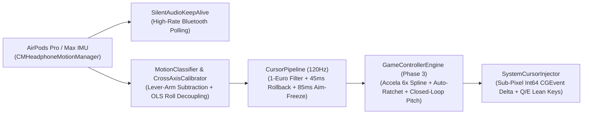
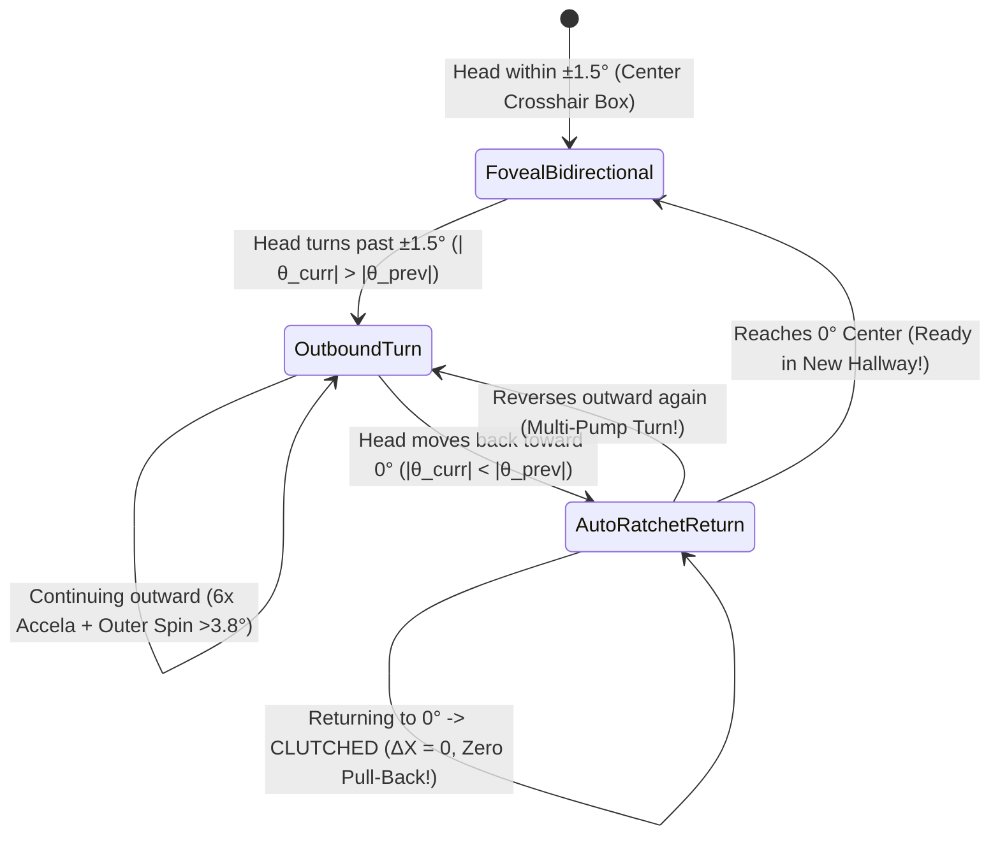

# Orient — Complete Engineering, Debugging & Research Chronicle (Phases 1 → 3)

This document records the complete technical evolution of **Orient** (AirPods 6-DOF Low-Latency macOS Cursor & 3D FPS Game Controller): every real-world hardware, OS, ergonomic, and gameplay issue discovered during testing, its mathematical or systems root cause, the HCI / head-tracking research literature consulted, and the exact code changes implemented to solve it.

---

## Table of Contents
1. [Architecture Evolution Overview (Phases 1 → 3)](#1-architecture-evolution-overview-phases-1--3)
2. [Issue #1: AirPods Bluetooth Polling Rate Drop & Display Jitter](#2-issue-1-airpods-bluetooth-polling-rate-drop--display-jitter)
3. [Issue #2: Click-Induced Crosshair Recoil (Nod/Tilt Moves Cursor Before Click Fires)](#3-issue-2-click-induced-crosshair-recoil-nodtilt-moves-cursor-before-click-fires)
4. [Issue #3: Swift 6 `@MainActor` Crash (`EXC_BREAKPOINT`) on AirPods Connection](#4-issue-3-swift-6-mainactor-crash-exc_breakpoint-on-airpods-connection)
5. [Issue #4: Unclickable macOS "Reopen Windows" Modal Alert & `codesign` Resource Fork Errors](#5-issue-4-unclickable-macos-reopen-windows-modal-alert--codesign-resource-fork-errors)
6. [Issue #5: Phase 2 — Excessive Roll Sensitivity, Anatomical Cross-Axis Bleed & Neck Lever-Arm Acceleration](#6-issue-5-phase-2--excessive-roll-sensitivity-anatomical-cross-axis-bleed--neck-lever-arm-acceleration)
7. [Issue #6: The "Non-VR Flat-Screen Disaster" (1:1 Mapping Forces Eyes Off the Monitor)](#7-issue-6-the-non-vr-flat-screen-disaster-11-mapping-forces-eyes-off-the-monitor)
8. [Issue #7: Phase 3 — Why External Browser 3D FPS Games (*Deadshot.io*) Initially Did Not Respond](#8-issue-7-phase-3--why-external-browser-3d-fps-games-deadshotio-initially-did-not-respond)
9. [Issue #8: Why Pressing `Recenter (⌥R)` Left the In-Game Screen Looking Down at the Floor](#9-issue-8-why-pressing-recenter-r-left-the-in-game-screen-looking-down-at-the-floor)
10. [Issue #9: Research-Backed Upgrade to `6x Micro-Gain` (TrackIR / Opentrack "Accela" Spline)](#10-issue-9-research-backed-upgrade-to-6x-micro-gain-trackir--opentrack-accela-spline)
11. [Issue #10: The 3D Hallway Navigation Problem — Solved via Auto-Ratchet Turn-Commit](#11-issue-10-the-3d-hallway-navigation-problem--solved-via-auto-ratchet-turn-commit)

---

## 1. Architecture Evolution Overview (Phases 1 → 3)

- **Phase 1**: 120Hz Predictive macOS Desktop Cursor Control, Casiez 1-Euro Adaptive Filter, Pre-Click Rollback, Aim-Freeze, Silent Audio Keep-Alive, and 2D Fitts's Law Benchmark Pad.
- **Phase 2 (Issue #1)**: Interactive SceneKit 3D Head-Tracking & 6-DOF Motion Disambiguation Lab (`MotionClassifier`, `CrossAxisCalibrator`, `DiagnosticBenchmarkEngine`, Guided 5-Step Feasibility Wizard).
- **Phase 3 (Issue #2)**: External 3D FPS Game Integration (*Deadshot.io*, *Krunker.io*, *Ev.io*, *PUBG*), PUBG `Q`/`E` Tactical Roll Lean, Click-Through Floating HUD (`InGameHUDWindow`), Carbon Global Hotkeys (`⌥Space`, `⌥R`, `⌥C`, `⌥M`), Closed-Loop Horizon Recenter, TrackIR/Opentrack Accela 6x Non-Linear Micro-Gain, and Auto-Ratchet Turn-Commit.

---

## 2. Issue #1: AirPods Bluetooth Polling Rate Drop & Display Jitter

### Problem
1. When macOS CoreAudio has no active audio stream routed to AirPods, the Bluetooth controller drops `CMHeadphoneMotionManager` IMU polling down to low-power intervals (`~25–30Hz`, `33–40ms` between packets).
2. Updating the cursor only when a Bluetooth packet arrives produces visible stepping on `120Hz` ProMotion displays, while raw gyroscope noise causes resting crosshair tremor.

### Solution
- **Zero-Amplitude Audio Keep-Alive (`Sources/OrientApp/SilentAudioKeepAlive.swift`)**: Runs an `AVAudioEngine` `AVAudioSourceNode` generating `0.0f` silent samples so the AirPods Bluetooth transport remains locked in its highest-rate sensor mode (`~80–100Hz`) with zero audible sound.
- **Casiez 1-Euro Adaptive Low-Pass Filter (`Sources/OrientCore/OneEuroFilter.swift`)**: Dynamically adapts the cutoff frequency based on instantaneous angular speed $|\dot{x}|$:
  $$f_c = f_{c,\min} + \beta \cdot |\dot{x}|$$
  At rest, a low cutoff (`1.35 Hz`) eliminates micro-jitter; during fast flicks, $\beta$ raises the cutoff above `30 Hz` for sub-`5ms` filter lag.
- **120Hz Predictive Upsampling (`Sources/OrientCore/CursorPipeline.swift`)**: Runs an independent `120Hz` (`8.33ms`) loop with exponential dead-reckoning decay if packet age exceeds `18ms`.

---

## 3. Issue #2: Click-Induced Crosshair Recoil (Nod/Tilt Moves Cursor Before Click Fires)

### Problem
Triggering a mouse click via a head tilt (`Roll`) or sharp head nod (`userAcceleration` impulse) takes `35–50ms` of physical head motion before crossing the detection threshold. During those `35–50ms`, the gyroscope sees the head moving and pulls the cursor off the target right before the click fires.

### Solution
- **45ms Pre-Click Cursor Rollback Ring Buffer (`Sources/OrientCore/CursorPipeline.swift`)**: Maintains a 90-entry timestamped ring buffer of cursor coordinates. When `GestureDetector` fires a click, the cursor is rolled back to its exact position `45ms` *before* the click gesture began (`lookupCursorPosition(atOrBefore: timestamp - 0.045)`).
- **85ms Aim-Freeze Window (`aimFreezeDurationMs`)**: Freezes cursor translation for `85ms` immediately upon gesture detection so physical head rebound never drags the click.

---

## 4. Issue #3: Swift 6 `@MainActor` Crash (`EXC_BREAKPOINT`) on AirPods Connection

### Problem
When connecting AirPods, `Orient` crashed immediately with `EXC_BREAKPOINT (SIGTRAP)` inside `_dispatch_assert_queue_fail`.

### Root Cause
In Swift 6 strict concurrency mode, any Objective-C block literal (such as `CMHeadphoneMotionManager.DeviceMotionHandler` or `MPRemoteCommandCenter` handlers) created inside a `@MainActor`-isolated method automatically inherits a compiler-synthesized `@MainActor` runtime assertion (`_dispatch_assert_queue(main)`). Because `CMHeadphoneMotionManager` invokes its callback on a background `OperationQueue` (`com.orient.headphonemotion.queue`), Swift's runtime trapped on the very first IMU packet.

### Solution
- Created a `nonisolated` enum factory (`NonIsolatedCallbackFactory` in `Sources/OrientApp/HeadphoneMotionController.swift`) completely outside `@MainActor` context to construct all Objective-C framework callbacks, then hopped explicitly to `worker.queue.async` and `DispatchQueue.main.async`.

---

## 5. Issue #4: Unclickable macOS "Reopen Windows" Modal Alert & `codesign` Resource Fork Errors

### Problem
1. After the initial crash, macOS displayed the system persistence alert (*"The last time you opened Orient, it unexpectedly quit while reopening windows"*), and neither button (`Reopen` / `Don't Reopen`) responded to clicks.
2. Packaging `Orient.app` inside `~/Desktop/Orient/build` failed `codesign` with `resource fork, Finder information, or similar detritus not allowed` because macOS Desktop/iCloud services continuously injected `com.apple.FinderInfo` extended attributes.

### Solution
1. **Dedicated Background Worker Queue (`BackgroundCursorWorker` in `Sources/OrientApp/HeadphoneMotionController.swift`)**: Moved the entire 120Hz `CursorPipeline` and `GameControllerEngine` timer off `DispatchQueue.main` onto a dedicated `.userInteractive` serial queue (`com.orient.engine120hz.queue`) and throttled SwiftUI `@Observable` telemetry updates to `~15Hz` with a backpressure guard (`!isUIUpdatePending`).
2. **Persistence Disabling (`Sources/OrientApp/OrientApp.swift` & `scripts/build_app.sh`)**: Set `ApplePersistenceIgnoreState = true` and `NSQuitAlwaysKeepsWindows = false` in `UserDefaults` and `Info.plist`, cleared `~/Library/Saved Application State/com.orient.cursorlab.savedState`, and deferred `startEngineIfNeeded()` to `.onAppear`.
3. **Clean `/tmp` Bundle Signing (`scripts/build_app.sh`)**: Assembles and signs the `.app` bundle inside `/tmp/OrientAppBuild/Orient.app` (outside Desktop/iCloud's `xattr` watcher) before copying to `./build/Orient.app`.

---

## 6. Issue #5: Phase 2 — Excessive Roll Sensitivity, Anatomical Cross-Axis Bleed & Neck Lever-Arm Acceleration

### Problem
When testing in the Phase 2 3D Spatial Lab (`Sources/OrientApp/Spatial3DLabView.swift`), the user observed:
1. **Roll Over-Sensitivity**: Natural head turns included slight ear-to-shoulder tilts (`Roll`) that destabilized the view.
2. **Anatomical Cross-Axis Coupling**: Tilting the head (`Roll`) caused unintentional `Yaw` and `Pitch` movement because the human C1–C2 cervical spine rotates along oblique anatomical axes rather than the orthogonal sensor axes of the AirPods.
3. **False Linear Acceleration During Rotation**: Because the AirPods sit at the ears roughly $r \approx 8.5\text{ cm}$ above the C1–C2 neck pivot, pure head rotation $(\vec{\omega}, \vec{\alpha})$ induces centripetal ($\vec{\omega} \times (\vec{\omega} \times \vec{r})$) and tangential ($\vec{\alpha} \times \vec{r}$) acceleration at the ears, fooling naive linear thresholds into thinking the user translated their head.

### Solution
1. **Neck Lever-Arm Kinematic Subtraction (`Sources/OrientCore/MotionClassifier.swift`)**: Computes the rotational acceleration $\vec{\alpha} = (\vec{\omega}_t - \vec{\omega}_{t-1})/\Delta t$ and induced ear acceleration $\vec{a}_{\text{rot}} = \vec{\alpha} \times \vec{r} + \vec{\omega} \times (\vec{\omega} \times \vec{r})$, then applies soft-threshold shrinkage (`attenuateTowardZero`) so pure head turns never trigger false linear translation events.
2. **Least-Squares Cross-Axis Roll Calibrator (`Sources/OrientCore/CrossAxisCalibrator.swift`)**: Records 2.5 seconds of pure left/right head tilts and solves Ordinary Least Squares (OLS) for `yawPerRoll` and `pitchPerRoll`, subtracting the user's personal anatomical Roll bleed in real time (`DecouplingMatrix`).
3. **4.5° Roll Deadzone Stabilization (`Sources/OrientCore/CursorPipeline.swift`)**: Suppresses Roll angles inside `±4.5°` (`rollDeadzoneDeg`) and adds independent Yaw/Pitch/Roll axis lock toggles.

---

## 7. Issue #6: The "Non-VR Flat-Screen Disaster" (1:1 Mapping Forces Eyes Off the Monitor)

### Problem
While testing the 3D Arena in Phase 2, the user identified a showstopping real-world ergonomic problem:
> *"I'm not in VR right — when moving I won't be looking at the screen! If I try to target something to the side by looking at it, I'm looking away from the screen altogether!"*

With a `1:1` VR-style mapping, turning the in-game camera $40^\circ$ requires turning your physical head $40^\circ$ away from your laptop/desktop monitor, meaning your face is pointed at the wall and you can no longer see the screen.

### Solution
- **The Non-VR Flat-Screen Law**: On a flat desktop monitor, **100% of physical head rotation must remain inside a $\pm 3^\circ\text{ to }\pm 5^\circ$ foveal micro-cone** so the user's eyes stay comfortably centered on the screen at all times.
- Built 4 Non-VR Aiming Paradigms (`microGainAmplified`, `gyroHybridTightEdge`, `velocityThumbstick`, `faceForwardRollAim`) and the **Guided 5-Step Feasibility Wizard** in `Spatial3DLabView.swift` and `GameControllerEngine.swift` to evaluate them side by side.

---

## 8. Issue #7: Phase 3 — Why External Browser 3D FPS Games (*Deadshot.io*) Initially Did Not Respond

### Problem
When the user first launched *Deadshot.io* in their browser, moving their head with AirPods did not move the in-game 3D camera at all.

### Root Causes & Fixes
1. **`CGEvent` Sub-Pixel Integer Truncation (`Sources/OrientApp/SystemCursorInjector.swift`)**:
   - **Root Cause**: In macOS CoreGraphics (`<CoreGraphics/CGEventTypes.h>`), `kCGMouseEventDeltaX` (`4`) and `kCGMouseEventDeltaY` (`5`) are **integer (`int64_t`) fields**. Calling `moveEvent.setDoubleValueField(.mouseEventDeltaX, value: 0.75)` truncated `0.75` to `Int64(0.75) == 0` (`NSEvent.deltaX == 0.0`). At `120Hz` (`8.33ms` per tick), normal head movements produce `< 1.0 px` per tick, so *Deadshot.io* received `event.movementX = 0` and `event.movementY = 0` on every frame!
   - **Fix**: Added sub-pixel fractional accumulators (`residualDeltaX`, `residualDeltaY`) in `SystemCursorInjector.moveCursor` and called `moveEvent.setIntegerValueField(.mouseEventDeltaX, value: intDX)` and `setIntegerValueField(.mouseEventDeltaY, value: intDY)` once the accumulated remainder crosses $\pm 1\text{ px}$.
2. **Cursor Drifting Outside the Locked Browser Canvas (`lockCursorInPlaceFor3DGame`)**:
   - **Root Cause**: Updating `mouseCursorPosition` to `currentPos + delta` on every tick dragged the macOS cursor right off the *Deadshot.io* `<canvas>` onto the browser address bar, tab bar, or macOS Dock within half a second, so clicking Left-Click to fire exited Pointer Lock and unfocused the game.
   - **Fix**: Added `lockCursorInPlaceFor3DGame = true` in `SystemCursorInjector.swift`, keeping `mouseCursorPosition` anchored inside the game window while injecting pure integer relative deltas (`mouseEventDeltaX`/`Y`), and automatically matching physical mouse button state (`.leftMouseDragged` when firing full-auto, `.rightMouseDragged` when ADS scoping, `.mouseMoved` otherwise).
3. **Global Hotkeys (`⌥Space`, `⌥R`, `⌥M`) Blocked in External Games (`CarbonHotKeyRouter`)**:
   - **Root Cause**: `NSEvent.addGlobalMonitorForEvents(matching: .keyDown)` requires active Input Monitoring / Accessibility trust for the exact binary hash and does not swallow keystrokes (typing `®` or `µ` into the game).
   - **Fix**: Replaced with Carbon `RegisterEventHotKey` (`CarbonHotKeyRouter` in `Sources/OrientApp/HeadphoneMotionController.swift`), which intercepts `⌥Space`, `⌥R`, `⌥C`, and `⌥M` at the WindowServer level in 100% of fullscreen apps without requiring Input Monitoring permissions.
4. **Stale Ad-Hoc `codesign` TCC Entries (`resetStaleTCCAndPromptAccessibility`)**:
   - **Root Cause**: Rebuilding with `codesign --sign -` changes the binary's `CDHash`, causing macOS TCC to silently reject `CGEvent.post` even while the old toggle in *System Settings → Accessibility* still looks switched ON.
   - **Fix**: Added `/usr/bin/tccutil reset Accessibility com.orient.cursorlab` before calling `AXIsProcessTrustedWithOptions` when `AXIsProcessTrusted()` is `false`.

---

## 9. Issue #8: Why Pressing `Recenter (⌥R)` Left the In-Game Screen Looking Down at the Floor

### Problem
While playing *Deadshot.io*, the user reported:
> *"When I press recenter, it recenters the cursor with the AirPods, but it does NOT move the game screen back to the center — my character is still looking down at the ground or somewhere else!"*

### Root Cause
1. **Open-Loop Non-Linear Velocity Drift**: Previously, `CursorPipeline` integrated angular velocity through a non-linear curve ($\int \text{sign}(\omega)|\omega|^{1.35}\,dt$). Because a non-linear function of velocity is **path-dependent**, tilting your head down fast (`40°/s` → `+280 px` downward) and bringing your head back up slowly (`8°/s` → `-90 px` upward) left the in-game camera displaced `+190 px` downward (staring at the floor) even when your physical head returned to $0^\circ$ looking straight at the monitor!
2. **Pointer-Lock Games Ignore Absolute Cursor Position**: In a 3D Pointer-Lock FPS game, resetting `referenceAttitude = currentHeadAttitude` only set `relativeAngles` to `(0°, 0°)` and emitted `deltaX = 0, deltaY = 0` — which did nothing to undo the `+190 px` downward camera offset already accumulated inside the game!

### Solution: Closed-Loop Horizon Synchronization (`Sources/OrientCore/GameControllerEngine.swift`)
- `GameControllerEngine` now tracks the exact **Virtual Camera Displacement (`virtualCameraX`, `virtualCameraY`)** injected into the game and computes vertical pitch deltas as a **Closed-Loop Position Differential**:
  $$\Delta Y_t = \text{TargetCam}_Y(\theta_{\text{pitch}, t}) - \text{virtualCameraY}_{t-1}$$
- **Zero Vertical Drift**: Whenever your physical head returns to level posture ($\theta_{\text{pitch}} = 0^\circ$), $\text{TargetCam}_Y(0^\circ) = 0$, so $\sum \Delta Y_t = 0$ — the in-game camera is mathematically guaranteed to return to the exact level horizon.
- **True Screen Recenter on `⌥R` (`onRecenterPressed()`)**: Pressing `⌥R` sets `smoothedPitchDeg = 0` (`TargetCam_Y = 0`) while preserving `virtualCameraY`, so the very next ticks automatically inject $-\text{virtualCameraY}$ back into the game, **physically rotating the in-game 3D screen right back up to the center horizon**.

---

## 10. Issue #9: Research-Backed Upgrade to `6x Micro-Gain` (TrackIR / Opentrack "Accela" Spline)

### Problem
Testing all 4 aiming modes in *Deadshot.io* showed that **Position-Mapped `6x Micro-Gain`** was much more intuitive than velocity thumbstick or roll modes (because human neck proprioception is naturally position-mapped via the Vestibulo-Ocular Reflex), **but** raw linear `6x` gain had three flaws:
1. It multiplied tiny $\pm 0.15^\circ$ heartbeat/neck tremors by `6x`, shaking the crosshair on small targets.
2. Symmetric vertical and horizontal gain caused vertical over-sensitivity (diving into the floor/sky).
3. Fast horizontal head flicks caused anatomical chin-dip ($\sim 1.5^\circ$ downward pitch), pulling the crosshair off head-level.

### Solution (`Sources/OrientCore/GameControllerEngine.swift`)
Drawing from flat-screen head-tracking HCI literature (*TrackIR*, *Opentrack's Accela filter*, and non-isomorphic 3D rotation research), we implemented 4 algorithms inside `GameControllerEngine`:
1. **3-Zone $C^1$ Accela Non-Linear Gain Spline (`evaluateAccelaNonLinearPixels`)**:
   - **Zone 1 — Foveal Precision Pocket ($0^\circ \le |\theta| \le 1.25^\circ$)**: Damps gain to `~2.3x` with a quadratic toe-in so micro-aiming on enemy heads is rock-steady.
   - **Zone 2 — Tactical Combat Ramp ($1.25^\circ < |\theta| \le 5.0^\circ$)**: Smoothly ramps gain up to `6.2x` (`nonLinearCurveExponent = 1.60`) so a $\pm 4^\circ$ turn sweeps the combat FOV.
   - **Zone 3 — Peripheral Flick Boost ($|\theta| > 5.0^\circ$)**: Boosts gain to `9x+` for rapid $180^\circ$ turns without looking away from the monitor.
2. **Velocity-Gated Tremor Filter (`updateSmoothedPose`)**: Applies strong low-pass smoothing (`alpha = 0.22`) and a `0.05°` tremor deadband when head angular speed is $< 4^\circ/\text{s}$ (holding aim), and opens to `alpha = 0.88` during fast flicks ($> 18^\circ/\text{s}$).
3. **Asymmetric Pitch-to-Yaw Anisotropy (`verticalPitchRatio = 0.55`)**: Scales vertical pitch sensitivity to `55%` of horizontal yaw sensitivity to match flat-monitor aspect ratios and neck ergonomics.
4. **Cross-Axis Dominant-Yaw Chin-Dip Suppression (`chinDipSuppressionStrength = 0.72`)**: Dynamically damps vertical pitch updates during fast horizontal flicks ($|\omega_{\text{yaw}}| > 12^\circ/\text{s}$ and $|\omega_{\text{yaw}}| > 1.8 |\omega_{\text{pitch}}|$) so horizontal turns stay level on the headshot horizon.

---

## 11. Issue #10: The 3D Hallway Navigation Problem — Solved via Auto-Ratchet Turn-Commit

### Problem
While navigating hallways in *Deadshot.io*, the user uncovered the core locomotion challenge of desktop head-tracking:
> *"Suppose I am going straight, I look left and go through the scene on the left by turning my head that side. Once I turn, I have to keep my head turned left the whole time just to keep looking that way! If I move my head back to normal in the middle of the screen, the camera turns back away — and if I want to turn MORE left, how much can I turn my head before I'm not looking at the screen at all?!"*

With a physical mouse, when you turn a $90^\circ$ left corner, you swipe left and then **lift the mouse off the mousepad ("ratchet")** to return your hand to the center without pulling the camera backward. Because you cannot lift your head off your neck, returning your head from $-3.5^\circ \to 0^\circ$ pulled the camera backward to the right.

### Solution: Auto-Ratchet Turn-Commit State Machine (`stepAutoRatchetYaw` in `Sources/OrientCore/GameControllerEngine.swift`)
Enabled on **both Option 1 (`1. Accela 6x Micro-Gain + Auto-Ratchet Turn`)** and **Option 2 (`2. Hybrid Gyro + ±5.5° Edge Spin + Auto-Ratchet`)**:

1. **Outbound Turn (`0° → -3.5°` Left)**: Moving your head away from the monitor center applies full `6x` Accela Micro-Gain (plus continuous spin if held past `3.8°`), turning your character `-90°` Left into the new hallway.
2. **Inbound Return to Monitor Center (`-3.5° → 0°`) — Automatic One-Way Clutch**: The instant your head begins returning toward `0°` from any turn beyond `ratchetTurnThresholdDeg` (`1.5°`), `isRatchetingReturnToCenter` latches `true` and emits **`ΔX = 0` for the entire return stroke back to `0°`**. Your character **stays facing the new left hallway with zero pull-back** while your head returns comfortably to the middle of the screen (`0°`).
3. **Infinite Multi-Pump Turning (`-90° → -180° → -360°`)**: Once your head is back at `0°`, turning `-3°` Left again turns the camera *another* `-90°` Left (just like lifting and swiping a mouse twice) without ever turning your head more than `~4°` off the monitor.
4. **Foveal Bidirectional Aiming (`±1.5°`)**: Inside `±1.5°` around the center of the monitor, movement remains **100% bidirectional** so you can track strafing enemies left and right without triggering the turn ratchet.
